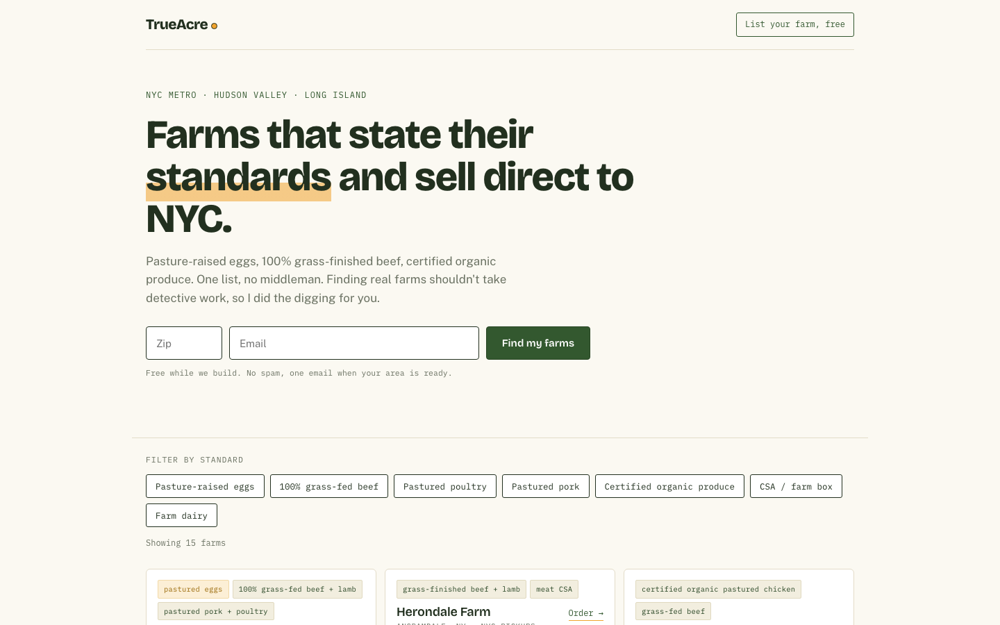

# TrueAcre

**Find clean local food near NYC.** TrueAcre (live beta) is a free directory that helps New York City consumers find farms by specific growing and raising practices, instead of broad labels like "organic."

> **Status: work in progress.** TrueAcre is a live beta that I'm still building. The numbers on this page come from my first round of research and launch, so treat them as early results. I'll update them as the directory grows.

**Live site:** https://trueacrefood.netlify.app

## Why I built it

Labels like "organic" and "natural" don't tell shoppers how their food was actually grown or raised. I wanted a way to compare farms on practices that can be checked.

## What I've done so far

These are the first steps of the project, from initial customer research to a live beta.

1. **Initial research.** Interviewed 20 prospective buyers and contacted 30 farms (12 responded) to learn what shoppers want to know and what farms can verify.
2. **Standards.** Sorted farms' stated practices into 7 verifiable standards.
3. **Product.** Launched a live, filterable directory of 15 farms, with a waitlist form for shoppers and a submission form for farms.
4. **Beta launch.** Released a live beta and grew a 50+ person waitlist for the full version by word of mouth.

The directory, the standards, and the farm list are all still changing as I talk to more buyers and farms.

## Tech

- A single-page site in HTML, CSS, and JavaScript (`index.html`)
- Designed and built with AI-assisted prototyping (Claude)
- Forms handled by Formspree
- Hosted on Netlify

## About

Built by Hannah Renner, Information Science and Communication student at Cornell University.
